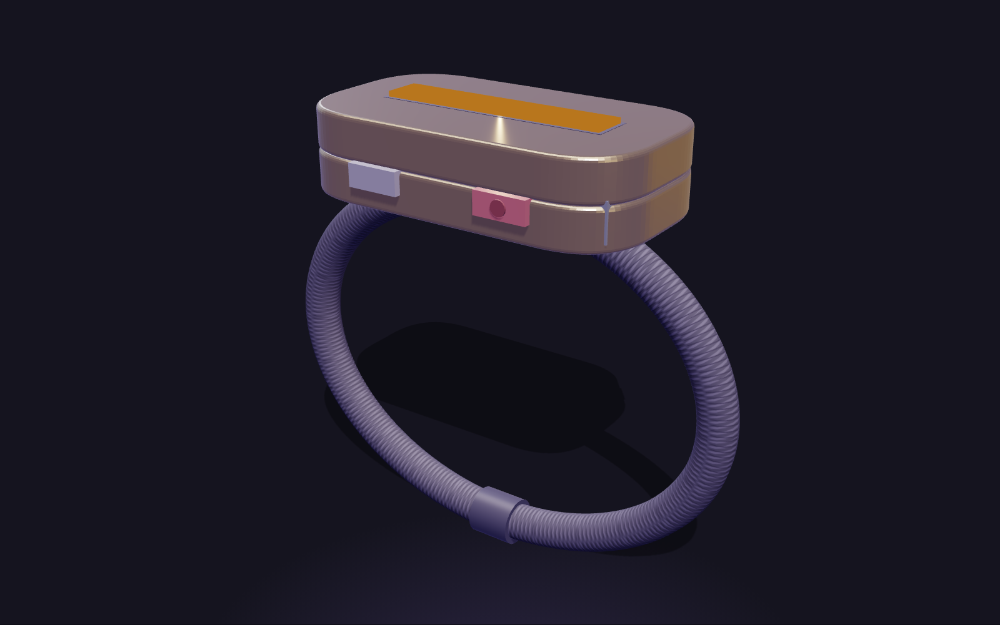
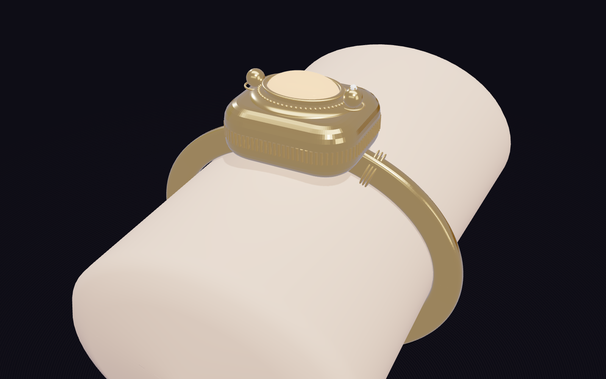
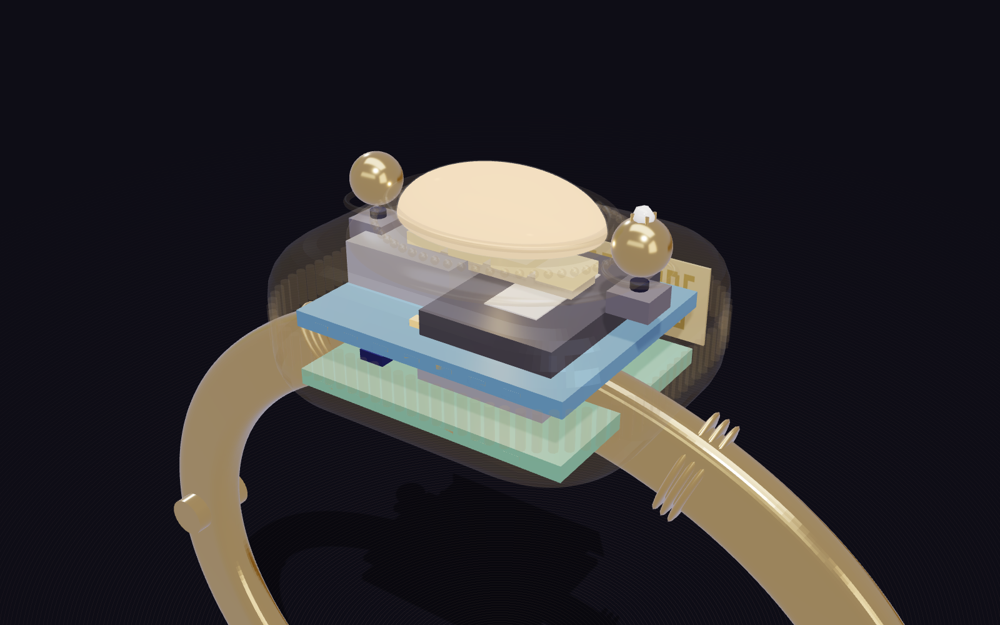
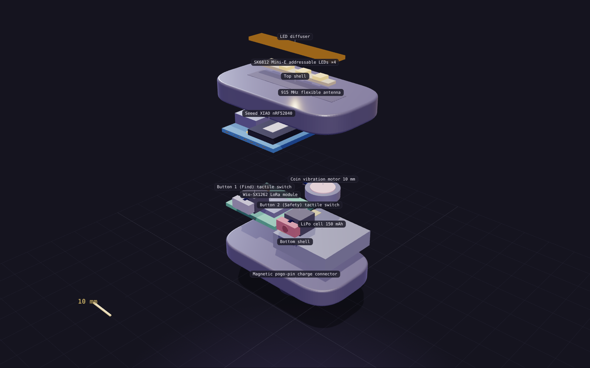
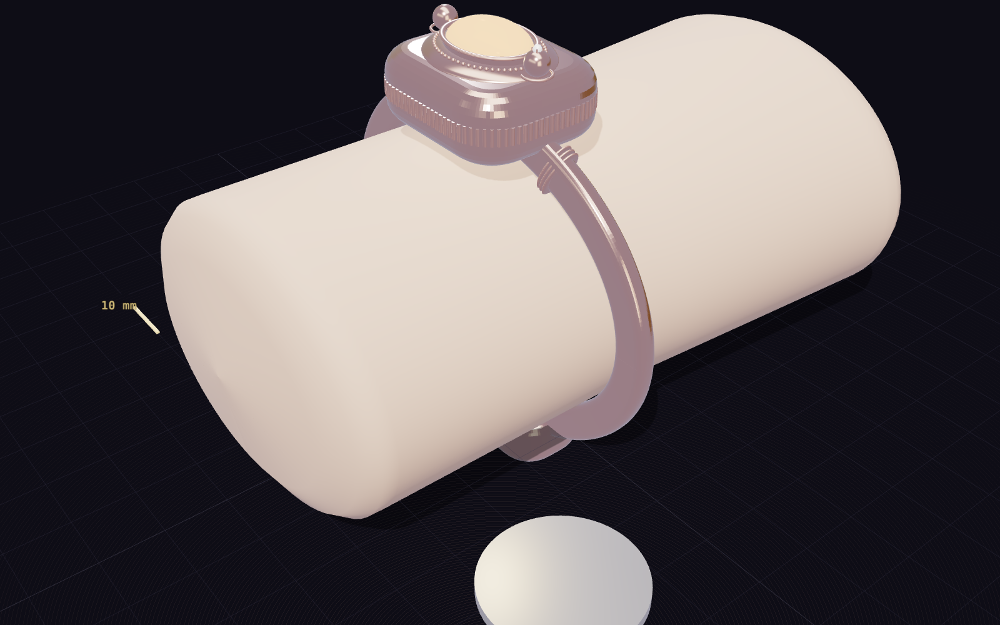

# Firefly

**A bracelet that finds your friends when your phone is dead.**

Firefly is a two-button, jewelry-weight band (44 × 24 × 11 mm pod, ~27 g with strap) with its own radio. It keeps a friend group connected inside packed bars and clubs with no signal, and it doesn't need the wearer's phone. One friend with battery runs the app; everyone else just wears the band.

| | |
|---|---|
|  |  |
|  |  |

## Promo video
[media/firefly-promo.mp4](media/firefly-promo.mp4): 53 seconds, 1080p. It's rendered from code in `media/promo-source/`.

## How it works
- **Button 1 · Find:** press once to find friends (the band pulses faster as you get closer), twice for "Come find me", hold for "I'm okay".
- **Button 2 · Safety:** press once for a discreet "I need help", twice to cancel, hold 3 s for SOS.
- **Band ↔ band:** LoRa at 915 MHz, 300 m+ indoors, no phone or cell signal needed.
- **Band ↔ app:** Bluetooth LE. The responsible friend's band relays everything to the app, which shows a map, a compass to each friend, and alerts.
- **Privacy:** no GPS on the band, an encrypted group key that expires at the end of the night, and nothing stored on a server.

## Repo layout

| Folder | What's inside |
|---|---|
| [`web/`](web) | Concept page (3D model, drawings, BOM, simulation, waitlist) and the phone web app. Open `web/index.html` in a browser. |
| [`hardware/`](hardware) | [`BUILD.md`](hardware/BUILD.md) step-by-step build guide, [`BOM.csv`](hardware/BOM.csv) parts list with prices and links, printable shell STLs, `make_stl.py` |
| [`firmware/`](firmware) | Arduino sketch for the Seeed XIAO nRF52840 + Wio-SX1262 |
| [`ios/`](ios) | SwiftUI iPhone app (CoreBluetooth + MapKit), with [run instructions](ios/README.md) |
| [`media/`](media) | Product renders and the promo video |

## Prototype cost
About **$55 per band** in off-the-shelf parts; roughly **$19 at 1,000 units** with a custom PCB and molded shell.

## Status
Concept and prototype design for an NYU class project. The firmware and iOS app are written but haven't been tested on hardware yet.
