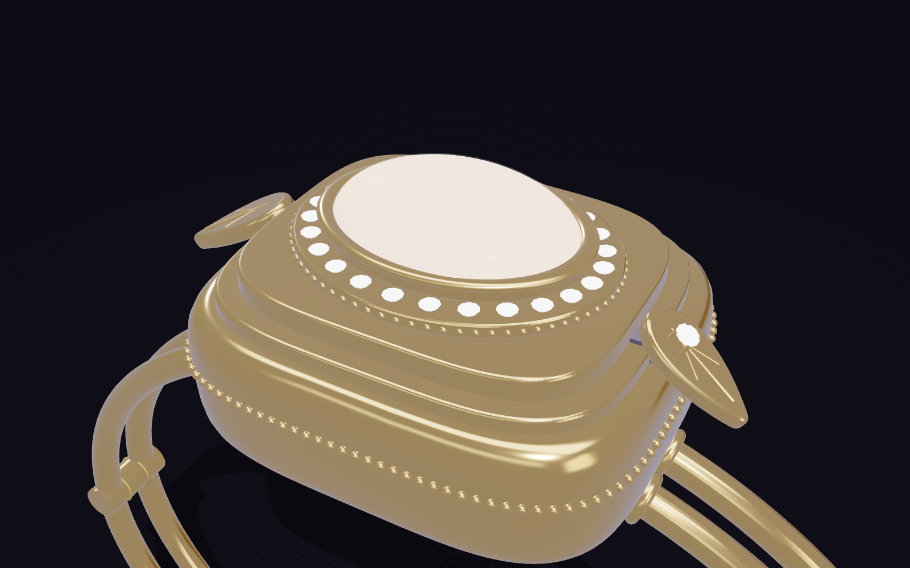

# Firefly

**A bracelet that finds your friends when your phone is dead.**

**Website & waitlist:** https://wendyxlin.github.io/firefly-band/ · **App (install on your phone):** https://wendyxlin.github.io/firefly-band/app/

Firefly is a fine-jewelry gold bangle (~22 g): a cushion-shaped centerpiece stepping up in Art Deco tiers to a halo of small white stones around a glowing opalite, two gold firefly wings for buttons, a slim twin-wire band, the battery hidden in the clasp, and its own radio. It keeps a friend group connected inside packed bars and clubs with no signal, doesn't need the wearer's phone, and tells your people when you get home. One friend with battery runs the app; everyone else just wears the band.

| | |
|---|---|
|  |  |
|  |  |

## Promo video
[media/firefly-promo.mp4](media/firefly-promo.mp4): 66 seconds, 1080p, rendered from code in `media/promo-source/`. Shows the gold bangle and every feature: Find, Help and SOS, "I'm okay" check-ins and the home-safe roll call.

## How it works
- **Button 1 · Find:** press once to find friends (the band pulses faster as you get closer), twice for "Come find me", three times for "I'm home", hold for "I'm okay".
- **Button 2 · Safety:** press once for a discreet "I need help", twice to cancel, hold 3 s for SOS.
- **I'm home:** triple-press Button 1. Friends in range hear it from the band, and your phone texts the people you picked as soon as it's charging.
- **Band ↔ band:** LoRa at 915 MHz, 300 m+ indoors, no phone or cell signal needed.
- **Band ↔ app:** Bluetooth LE. The responsible friend's band relays everything to the app, which shows a map, a compass to each friend, and alerts.
- **Privacy:** no GPS on the band, an encrypted group key that expires at the end of the night, and nothing stored on a server.

## Repo layout

| Folder | What's inside |
|---|---|
| [`docs/`](docs) | Public website (GitHub Pages): landing page with video and waitlist, the installable app in `docs/app/`, and the full concept page in `docs/concept/` |
| [`web/`](web) | Concept page (3D model, drawings, BOM, simulation, waitlist) and the phone web app. Open `web/index.html` in a browser. |
| [`hardware/`](hardware) | [`BUILD.md`](hardware/BUILD.md) step-by-step build guide, [`BOM.csv`](hardware/BOM.csv) parts list with prices and links, printable centerpiece and clasp-box STLs, `make_stl.py` |
| [`firmware/`](firmware) | Arduino sketch for the Seeed XIAO nRF52840 + Wio-SX1262 |
| [`ios/`](ios) | SwiftUI iPhone app (CoreBluetooth + MapKit), with [run instructions](ios/README.md) |
| [`media/`](media) | Product renders and the promo video |

## Prototype cost
About **$76 per band** in off-the-shelf parts; roughly **$34 at 1,000 units** with a custom PCB and cast gold-plated brass, for a $149–199 retail price.

## Status
Concept and prototype design for an NYU class project. The firmware and iOS app are written but haven't been tested on hardware yet.
