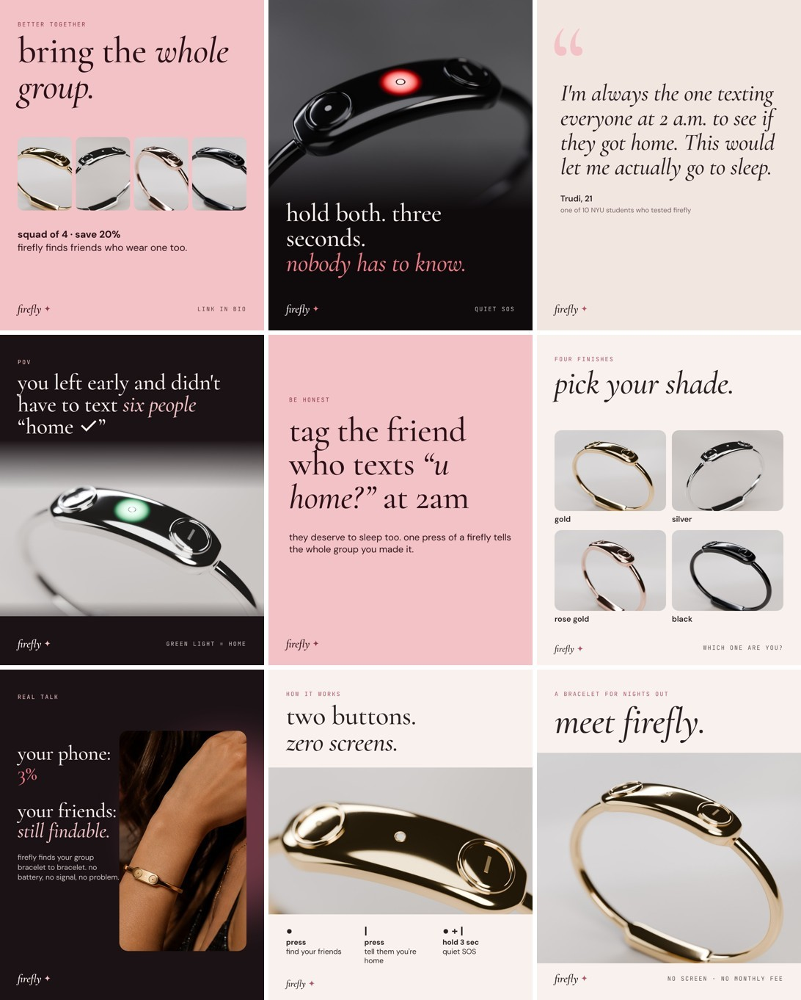
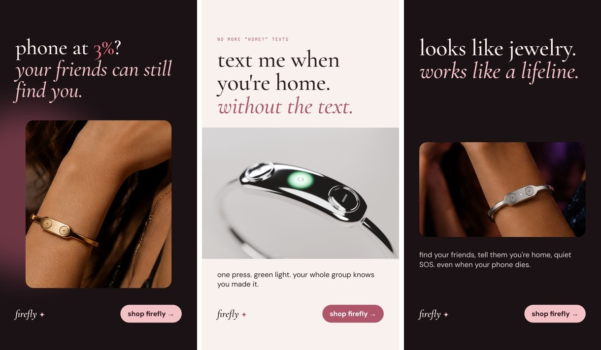

# Firefly Instagram Kit (Sprint 3)

Everything to launch Firefly's Instagram for college students: profile, 9 launch posts with captions, 3 story ads for the acquisition test, highlight covers, reel ideas and a posting calendar. All images are in this folder (and in the BTE Capstone Drive folder, "Firefly Instagram Kit").

## Profile

| Field | What to use |
| --- | --- |
| Handle | Check in this order: **@wearfirefly**, @firefly.bracelet, @fireflyband.nyc |
| Name | Firefly ✦ bracelet for nights out |
| Category | Jewelry / Watches (Business account, so ad insights work) |
| Bio (119 of 150 characters) | find your friends + tell them you're home, even when your phone dies ✦ no screen, no monthly fee · made by NYU students |
| Link | https://wendyxlin.github.io/firefly-band/v2-bracelet/?utm_source=ig_bio |
| Profile picture | `profile-picture.jpg` |
| Story highlights | `highlight-how-it-works.jpg`, `highlight-shades.jpg`, `highlight-squad.jpg`, `highlight-faq.jpg` |

Use a Business (or Creator) account from day one: the shop link in the bio, post insights and paid ads all need it.

## Voice

Lowercase, short, a little funny, never preachy about safety. Talk like a friend in the group chat, not a safety brand. Every claim must match the shop page; nothing about availability dates.

## The 9 launch posts (4:5, 1080 × 1350)

Post them in this order (1 first). Post 1–3 on launch day so the profile never looks empty, then one a day.

| # | File | Caption |
| --- | --- | --- |
| 1 | `post1-meet-firefly.jpg` | meet firefly ✦ a bracelet that finds your friends and tells them you made it home, even when your phone is dead. two buttons, one tiny light, no screen. made by a group of NYU students who were tired of "u home?" texts. link in bio |
| 2 | `post2-two-buttons.jpg` | the whole thing is two buttons. dot = find your friends (it buzzes faster as you get closer). line = "i'm home". hold both for 3 sec = quiet SOS. that's it. that's the post. |
| 3 | `post3-phone-3-percent.jpg` | the 3% panic is real. firefly finds your group bracelet to bracelet, so your dead phone isn't the end of the night. #nightout #collegelife |
| 4 | `post4-pick-your-shade.jpg` | gold, silver, rose gold or black. drop your pick in the comments 👇 |
| 5 | `post5-tag-the-friend.jpg` | every group has one. tag them so they can finally sleep. |
| 6 | `post6-pov-home.jpg` | pov: you left early and the whole group already knows you're home. one press, green light, no texts. |
| 7 | `post7-trudi-quote.jpg` | we put firefly in front of 10 NYU students. this is what Trudi said. 8 of 10 found a hidden friend with no hints, and 9 of 10 pressed "i'm home" first without being told. |
| 8 | `post8-quiet-sos.jpg` | hold both buttons for three seconds. your location goes to your group and a backup contact. nobody around you can tell. you get a few seconds to cancel. |
| 9 | `post9-squad.jpg` | firefly finds friends who wear one too, so bring the whole group: squad of 4, save 20%. link in bio ✦ |

Hashtags (pick 3–5, at the end of the caption): #nyu #nyustern #collegelife #nightout #girlsnightout #nycnightlife #besties

## Story ads for the acquisition test (9:16, 1080 × 1920)

| Ad | File | Message | Link |
| --- | --- | --- | --- |
| A | `ad-A-finding.jpg` | phone at 3%? your friends can still find you. | https://wendyxlin.github.io/firefly-band/v2-bracelet/?utm_source=ig_ad&utm_content=A |
| B | `ad-B-home.jpg` | text me when you're home. without the text. | https://wendyxlin.github.io/firefly-band/v2-bracelet/?utm_source=ig_ad&utm_content=B |
| C | `ad-C-jewelry.jpg` | looks like jewelry. works like a lifeline. | https://wendyxlin.github.io/firefly-band/v2-bracelet/?utm_source=ig_ad&utm_content=C |

Settings: Stories and Reels placements, ages 18–24, within about 5 miles of Washington Square, $20 per ad over the same 5–7 days, button "Shop now". Don't add `?p=` to ad links, so each ad's visitors still get the random price and the two tests stay independent.

Other links, so every visit is tagged in the sheet:

- Group chats: `...v2-bracelet/?utm_source=groupchat`
- Flyers / QR codes: `...v2-bracelet/?utm_source=flyer`
- Instagram stories (organic link sticker): `...v2-bracelet/?utm_source=ig_story`

## Reels (ready to post, 9:16, 1080 × 1920)

Four finished reels are in `reels/`, each with a cover image. They copy the formats that sell products to the same audience right now: a hook in the first second, 7–15 seconds long, big on-screen text so they work with sound off, one message each, and a clear "link in bio" ending. They have no music, so add a trending sound in the Instagram app when you post (keep it quiet under the text).

| # | File | Format it copies | Caption |
| --- | --- | --- | --- |
| 1 | `reel1-u-home.mp4` (11 s) | "POV" text-message hook, then the product as the fix | pov: you're the friend who can't sleep until everyone's home. firefly = one button, green light, whole group knows. no texts. link in bio ✦ #nightout #collegelife #girlsnight |
| 2 | `reel2-three-reasons.mp4` (13 s) | Numbered "3 reasons" list, the format safety brands like She's Birdie use | 3 reasons firefly is coming on every night out. which one sold you? 1, 2 or 3 👇 link in bio ✦ #nyu #nightout #besties |
| 3 | `reel3-pick-your-shade.mp4` (7 s) | Fast colour reveal with a comment prompt, the jewelry-brand staple | gold, silver, rose gold or black. comment your shade 👇 #jewelry #goldjewelry #nightout |
| 4 | `reel4-phone-died.mp4` (12 s) | Problem → product demo | your phone died. your friends didn't lose you. firefly finds your group bracelet to bracelet, no phone needed. link in bio ✦ #collegelife #nycnightlife |

**As ads:** boost Reel 1, 2 and 4 with the same settings as the story ads (ages 18–24, about 5 miles around Washington Square, button "Shop now"). Links, so each reel is tagged in the sheet and PostHog:

- Reel 1: `https://wendyxlin.github.io/firefly-band/v2-bracelet/?utm_source=ig_ad&utm_content=R1`
- Reel 2: `https://wendyxlin.github.io/firefly-band/v2-bracelet/?utm_source=ig_ad&utm_content=R2`
- Reel 4: `https://wendyxlin.github.io/firefly-band/v2-bracelet/?utm_source=ig_ad&utm_content=R4`

Post each one first as a Trial Reel (shown to non-followers only), check watch time and link clicks after 24 hours, and put the ad money behind the best one.

### Film these too (real people beat graphics)

Videos with a real person filmed on a phone usually beat polished graphics, so film these three with the team and use the reels above as the script:

1. **"the group parent at 2am"**: phone screen with "u home?" sent to five chats, then cut to a wrist pressing the line button and the light going green. Text on screen: "or… one button."
2. **"pick your shade"**: screen-record the 3D model (https://wendyxlin.github.io/firefly-band/v2-bracelet/mockup/) spinning through the four finishes, one beat per colour. Text: "which one are you?"
3. **"phone died at the club"**: three quick clips (dark venue, 1% battery screen, friends' wrists buzzing). Text: "your phone died. your friends didn't lose you." End card: link in bio.

## Stories (daily, 3–5 frames)

- Poll: "are you the group parent?" yes / no, it's my friend
- Quiz: "how many 'home?' texts do you send after a night out?" 0 / 1–2 / 3–5 / too many
- Slider: "how much do you hate when your phone dies at 1am?"
- Link sticker to the shop every day, tagged `utm_source=ig_story`

## Calendar

| Date | Post | Stories / ads |
| --- | --- | --- |
| Wed Nov 4 | Posts 1, 2, 3 | Launch story: "we made a thing" + link |
| Thu Nov 5 | Post 4 | Poll: group parent |
| Fri Nov 6 | Reel 1 | Quiz: "home?" texts |
| Sat Nov 7 | Post 5 | Repost tags from post 5 |
| Sun Nov 8 | Post 6 | Slider + link |
| Mon Nov 9 | Post 9 (squad) | Ads A, B, C go live |
| Tue Nov 10 | Reel 2 | Link sticker |
| Wed Nov 11 | Post 7 | Share 1–2 shop numbers ("40 of you tried to check out") only if true |
| Thu Nov 12 | Post 8 | Link sticker |
| Fri Nov 13 | Reel 3 | Move ad money to the best ad |

## How the numbers come back

Every shop visit, add to cart, checkout click and notify-me email lands as a `[shop]` row in the Firefly waitlist Google Form's response sheet, with the price shown, the pack, the colour and the `utm_source` / `utm_content` tag. Filter the sheet by `ad=A`, `ad=B`, `ad=C` to compare the ads, and by `src=` to compare channels. Put the Instagram dashboard's impressions, clicks and spend next to them to get cost per checkout click.

## Rebuilding the images

`source/reels.html`, `source/reels_render.py` and `source/reels_encode.py` build the reels the same way. `source/ig.html` draws every post from the renders in `v2-bracelet/renders`; `source/render.py` screenshots each one with Playwright. Edit the copy in `ig.html` and re-run to update a post.
